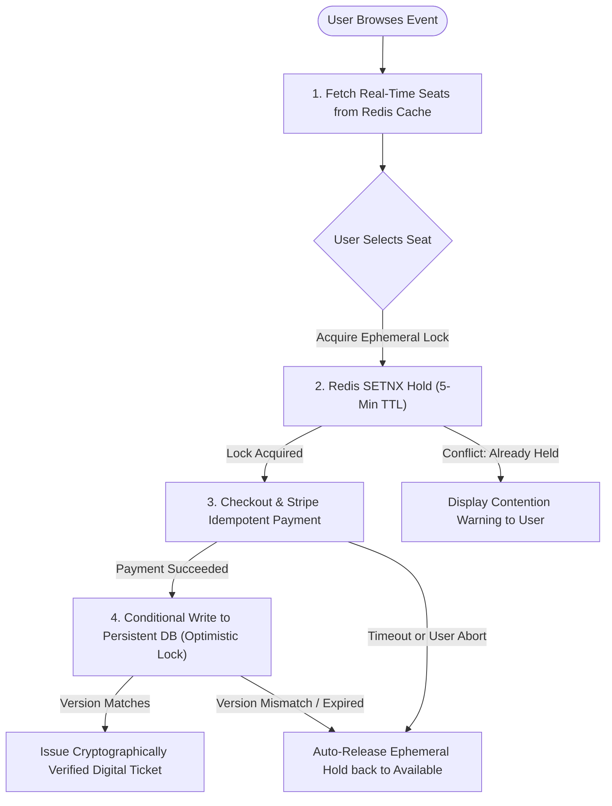

# AtomicSeat: Scalable Ticket Management System for High-Concurrency Event Ticketing

> **Major Project for Bachelor of Technology (Computer Science & Engineering)**  
> **Institution**: I.K. Gujral Punjab Technical University (IKGPTU), Mohali Campus-1  
> **Submitted To**: Mrs. Manpreet  
> **Submitted By**:  
> - Sparsh Gupta (Roll No. 2328066)  
> - Manpreet Singh (Roll No. 2328040)  
> - Kamaldeep Singh (Roll No. 2328030)  
> **Session**: September 2026  

---

## 1. Problem Statement: The Concurrency Contention Crisis

During high-demand ticket sales (such as Coldplay concert tours, ICC World Cup/Champions Trophy finals, or IRCTC Tatkal train reservations), tens of thousands of users compete for a tiny inventory of seats within seconds.

A naive CRUD implementation relies on read-then-write logic:
```sql
-- Step 1: Check availability
SELECT * FROM seats WHERE id = 'A1' AND status = 'AVAILABLE';
-- Step 2: Write update
UPDATE seats SET status = 'BOOKED' WHERE id = 'A1';
```

Under heavy concurrency, dozens of concurrent requests pass the `SELECT` check **before** any request commits the `UPDATE`. This creates a race condition window resulting in **catastrophic double-selling** of the exact same seat. Furthermore, naive database locking (`SELECT ... FOR UPDATE`) triggers severe connection pool exhaustion, thread starvation, and cascading timeouts.

---

## 2. The AtomicSeat Solution: Countering Every Major Issue

| Vulnerability / Failure Mode | Root Cause in Naive Platforms | AtomicSeat Architectural Countermeasure |
| :--- | :--- | :--- |
| **Race Conditions / Double-Booking** | Read-then-write race window allows multiple threads to overwrite the same record. | **Two-Tier Concurrency Strategy**: Ephemeral in-memory hold (`SETNX` with TTL) + Persistent Conditional Write (`WHERE version = :currentVersion AND heldBy = :token`). |
| **Database Lock Exhaustion & Deadlocks** | Row/table locking blocks DB pools under thousands of simultaneous requests. | **Decoupled In-Memory Layer**: High-velocity lock arbitration is processed in Redis memory (<1ms) before persistent writes are touched. |
| **Inventory Hoarding & Ghost Holds** | Abandoned checkouts leave seats locked indefinitely. | **5-Minute TTL (Time-To-Live)**: Ephemeral hold expires automatically after 300 seconds, releasing the seat back to the available pool. |
| **Payment Idempotency Failures** | Double-clicks or network retries trigger duplicate bookings or double charges. | **Cryptographic Idempotency Keys**: Requests carry a unique `Idempotency-Key`. Replays return the cached result safely without re-charging. |
| **Flash-Crowd API Saturation** | 50,000 requests hitting backend endpoints simultaneously. | **Token-Bucket Virtual Waiting Room**: Sequential queue admission buffers traffic spikes safely before users enter the seat map. |

---

## 3. End-to-End Reservation Lifecycle



---

## 4. Architectural Deliberate Trade-off: CAP Theorem

- **Redis Cache (AP - Availability & Speed)**: Real-time seat inventory is eventually consistent, optimized for massive read throughput and microsecond ephemeral holds.
- **Persistent Database (CP - Strong Consistency)**: Final confirmed bookings execute via strict conditional writes (`WHERE version = currentVersion`), guaranteeing zero double-sell anomalies.

---

## 5. Built-in High-Concurrency Stress Test Simulator

The application includes an integrated **Bot Burst Simulator** allowing professors, examiners, and developers to test:
- **10 to 200 concurrent bot requests** simultaneously targeting a single hot seat (e.g. Seat A1 VIP).
- Side-by-side execution:
  - **Naive CRUD Mode**: Recreates the race condition bug live, showing multiple bots receiving confirmed tickets for the same seat (**Double-Booking Anomaly Detected!**).
  - **AtomicSeat Mode**: Exactly 1 bot acquires the seat, all other bots are deflected cleanly in sub-milliseconds (**0 Double Bookings, 100% ACID Integrity**).

---

## 6. How to Run Locally

### Prerequisites
- Node.js v18+ or v22+
- npm v10+

### Steps
```bash
# 1. Navigate to the project directory
cd C:\Users\manpr\.gemini\antigravity\scratch\atomicseat

# 2. Run the development server
npm run dev

# 3. Open in your browser
http://localhost:3000
```

### Build for Production
```bash
npm run build
npm run start
```
